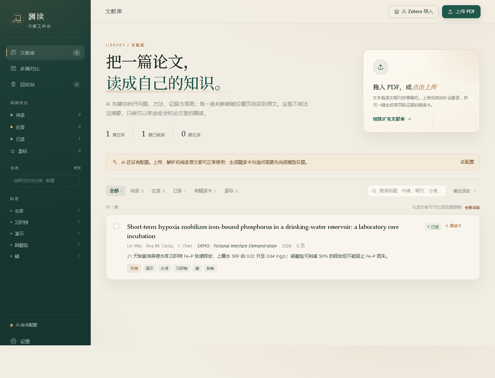
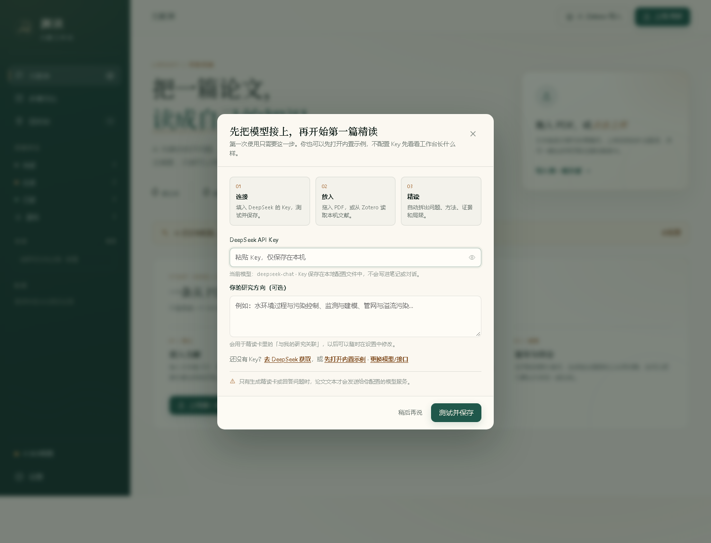

# 澜读 · 文献工作台

一个**本地优先**的论文精读工具：把 PDF 放进来，生成结构化的精读卡，并围绕原文继续追问、核对引用、比较多篇文献。

论文、笔记和对话都保存在你自己的电脑上；AI 请求只发送给你自己配置的模型服务。

## 下载

- [Windows 桌面版](../../releases/latest)：解压后双击 `澜读文献工作台.exe`，打开独立窗口，不需要浏览器，也不需要安装 Python。
- [源码 ZIP](../../archive/refs/heads/main.zip)：适合 macOS / Linux，或想自己改代码的人。

> Windows 桌面版请在仓库的 **Releases** 页面下载；源码版需要 Python 3.10+。




## 它能做什么

- **结构化精读卡**：核心问题、创新点、研究方法、主要结论、局限与可借鉴之处。
- **四种精读模式**：综合精读全覆盖；方法细读、写作借鉴、审稿人视角只深挖各自维度。
- **原文证据核验**：引用可跳转到 PDF 页码；自动标出最可能对应的原句，区分已核验、待确认和未自动核验。
- **围绕论文追问**：回答尽量基于原文，并给出页码依据；支持继续追问和多种回答口吻。
- **多篇对比**：选择几篇文献，生成研究问题、方法、结论和分歧点的对照。
- **我的收获**：每篇论文一份可编辑的读书笔记，可由 AI 先起草，之后随时补充。
- **研究方向分类**：自定义分类和颜色，给一篇文献挂多个方向，侧栏按方向筛选。
- **回收站**：删除先进入回收站，可恢复或彻底删除。
- **Zotero 导入**：从本机 Zotero 7 桌面端读取题录和 PDF。
- **Obsidian 导出**：把精读卡、收获和笔记写成 Markdown，直接放进本机笔记库；不会覆盖你改过的笔记。
- **手机访问**：同一 Wi-Fi 下用手机浏览器打开，使用 6 位访问码登录。
- **内置示例**：没有 API Key 也可以先打开虚构示例，看看界面和精读卡长什么样。

## 适合谁

适合希望自己掌控论文和笔记、愿意配置一个模型 API 的研究生、科研人员和独立研究者。

它**不是**一个多用户在线服务：一个解压目录对应一份本地文献库。请每个人下载自己的副本、使用自己的 API Key；不要多人共用一个正在运行的实例。

## 系统要求

- Windows 10/11 或 macOS / Linux
- 源码版需要 Python **3.10 或更高版本**（推荐 3.12）；Windows 桌面版不需要
- Windows 桌面版需要 Microsoft Edge WebView2 Runtime（Windows 10/11 通常已随 Edge 安装）
- 一个兼容 OpenAI Chat Completions 接口的模型服务：
  - 默认支持 DeepSeek
  - 也内置通义千问、智谱 GLM、OpenAI 的预设
  - 可填任意兼容接口，或本机 Ollama（本地地址不强制要求 Key）

源码版首次运行需要联网安装两个 Python 依赖：`requests` 和 `pymupdf`。如果使用 Windows 桌面版，则不需要安装 Python。

## 快速开始

### Windows 桌面版（推荐给不想装 Python 的人）

如果不想安装 Python，使用 Release 里的 `landu-workbench-windows-desktop.zip`：

1. 解压整个文件夹，不要直接在压缩包里双击。
2. 双击 **`澜读文献工作台.exe`**。
3. 如果 Windows 弹出 SmartScreen 提示，点 **更多信息 → 仍要运行**。
4. 会打开一个独立的「澜读 · 文献工作台」窗口，没有浏览器地址栏和标签页；按提示填自己的 API Key 和研究方向。

数据保存在 exe 旁边的 `data/`。移动程序时请把 `data/` 一起带走；备份时复制整个文件夹即可。关闭窗口会停止工作台服务；手机访问需要保持窗口打开（可以最小化）。

### Windows 源码版

1. 安装 Python 3.10+：<https://www.python.org/downloads/>。安装时勾选 **Add Python to PATH**。
2. 解压整个文件夹（不要只把 `.bat` 拖出来）。
3. 双击 **`启动工作台.bat`**。首次运行会自动安装依赖，随后浏览器会打开 `http://127.0.0.1:8765`。
4. 按页面提示填入 API Key；研究方向可以一起填，也可以稍后在「设置」里补。



如果双击后窗口一闪而过，请在该文件夹空白处按住 Shift 右键，选择「在此处打开 PowerShell 窗口」，运行：

```powershell
python app.py
```

这样能看到具体报错。

### Windows 桌面版（源码运行）

如果你已经有 Python 环境，也可以直接打开原生桌面窗口，不经过浏览器：

```bash
python -m pip install -r requirements-desktop.txt
python desktop.py
```

窗口关闭即停止服务；首次需要 Microsoft Edge WebView2 Runtime（Windows 10/11 通常已随 Edge 安装）。

### macOS / Linux

```bash
cd landu-workbench
chmod +x start.sh
./start.sh
```

也可以手动运行：

```bash
python3 -m pip install -r requirements.txt
python3 app.py
```

启动后打开 <http://127.0.0.1:8765>。关闭终端窗口即停止服务。

### 依赖安装很慢

可以使用国内镜像：

```bash
python -m pip install -r requirements.txt -i https://pypi.tuna.tsinghua.edu.cn/simple
```

## 首次配置

1. 打开「设置 → AI 模型」，选择服务商，填入 API Key。
2. 点「测试连接」，确认账户可用。
3. 在「阅读与输出 → 我的研究背景」写下你的研究方向。写得越具体，精读卡最后一节「与我的研究关联」越有用。
4. 回到文献库，拖入 PDF，或从 Zotero 导入。

获取 Key 的入口：

- DeepSeek：<https://platform.deepseek.com/api_keys>
- 通义千问：<https://bailian.console.aliyun.com/>
- 智谱 GLM：<https://open.bigmodel.cn/>
- OpenAI：<https://platform.openai.com/api-keys>

## 数据放在哪里

所有本地数据都在程序目录下的 `data/`：

```
data/
├── config.json          # 模型配置（含 API Key，明文）
├── categories.json      # 研究方向分类
├── obsidian_exports.json
├── papers/              # 每篇论文一个文件夹：PDF、精读卡、对话、笔记
├── comparisons/         # 多篇对比结果
├── trash/               # 回收站
└── tmp/                 # 临时文件
```

备份时直接复制整个文件夹即可。**不要把 `data/` 上传到 GitHub、网盘公开链接或聊天群**，因为 `config.json` 里保存着你的 API Key 和论文内容。

换电脑时，复制整个程序目录（含 `data/`）过去即可继续使用。

## 可选功能

### Zotero

需要 Zotero 7 桌面端保持运行，并在 Zotero 设置中允许本地 API。默认地址是 `http://127.0.0.1:23119`，User ID 通常填 `0`。在「设置 → Zotero」测试连接后，即可从文献库导入。

### Obsidian

在「设置 → Obsidian」选择包含 `.obsidian` 文件夹的笔记库，设置子文件夹。导出时写入带 YAML 属性的 Markdown。若你在 Obsidian 里改过同名笔记，程序会另存副本，不会覆盖。

### 手机访问

在电脑端「设置 → 手机访问」开启，设置 6 位访问码。手机与电脑连接同一个 Wi-Fi，用手机浏览器打开页面显示的局域网地址，输入访问码即可。

- 只建议在可信的家庭、办公室网络中使用。
- 电脑需要保持开机。
- 若手机打不开，检查 Windows 防火墙是否允许 Python，以及路由器是否开启了 AP 隔离。
- **不要**把 8765 端口映射到公网，也不要用 ngrok、Cloudflare Tunnel 等工具把本机端口直接暴露出去。本项目是单用户工具，不具备公网多用户隔离能力。

## 隐私与安全

- **API Key 以明文保存在 `data/config.json`**。这是为了让你完全掌控本地数据；请勿分享该文件。
- 只有生成精读卡、追问、对比或 AI 起草收获时，相关论文文本才会发送给你配置的模型服务。若使用第三方中转站，论文内容会经过该服务；未发表数据请自行评估风险，或改用本机 Ollama。
- 导入 PDF 时可能会用 DOI 或题录信息向 Crossref 查询元数据，但不会上传 PDF 全文。
- 服务会监听 8765 端口（本机与局域网）。未开启手机访问时，局域网设备只能看到登录提示，无法读取文献；开启后需要访问码。请勿将服务直接暴露到公网。
- 本工具不提供论文下载或破解功能。请只处理你有权使用的文献，遵守数据库和出版方的许可。
- AI 生成内容可能有误。引用、页码和结论请以原文为准；程序会尽力标出证据，但不能替代人工核对。

## 常见问题

**提示 `Python was not found`**

安装 Python 时没有勾选 Add Python to PATH。重新安装并勾选，或使用完整路径运行。

**端口被占用**

程序会自动尝试 8765–8784。若全部占用，关闭占用端口的程序后重试。

**上传后没有自动生成精读卡**

检查 PDF 是否为文本版（扫描版需要先 OCR），以及「设置 → 上传后自动生成精读卡」是否开启。生成会消耗模型额度。

**手机能打开登录页，但进不去**

确认访问码输入正确；在电脑端「设置 → 手机访问」查看或更换访问码。若一直转圈，检查防火墙和 Wi-Fi 是否在同一网段。

**Obsidian 导出失败**

确认选择的是包含 `.obsidian` 的笔记库目录，并且当前用户有写入权限。

## 目录结构

```
app.py                 # HTTP 服务、路由和 API
ai.py                  # 提示词与模型请求
storage.py             # 本地数据、PDF、分类、回收站、Obsidian
zotero.py              # Zotero 本地 API
desktop.py             # Windows 桌面窗口入口（WebView2）
static/                # 前端页面、样式和脚本
demo/                  # 虚构示例论文与示例精读卡
data/                  # 运行后生成的本地数据（不进入版本库）
requirements.txt
requirements-desktop.txt
启动工作台.bat          # Windows 浏览器版启动器
start.sh               # macOS / Linux 启动器
```

## 反馈与改进

这是一个人维护的本地工具。遇到问题时，先看启动窗口和浏览器控制台的报错；提交问题时请附上复现步骤，并**删除 API Key、论文内容和私人路径**。

## 许可

MIT License，详见 [LICENSE](LICENSE)。内置示例论文、作者、数据和参考文献均为虚构，仅用于展示功能。
